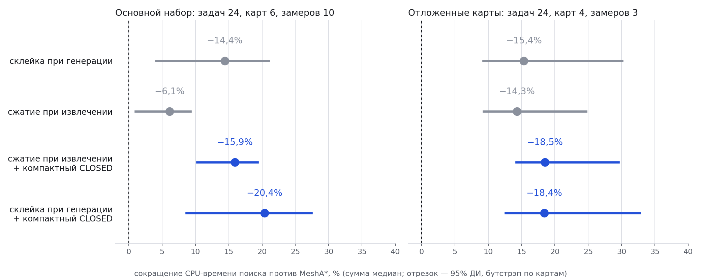
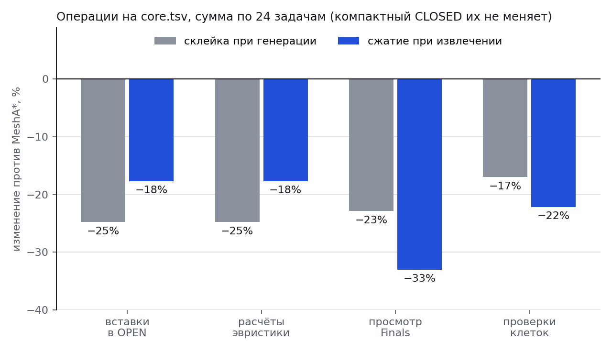

# Склеивание цепочек в MeshA*

Реализация склеивания внутренних цепочек MeshA* и результаты сравнения с исходным алгоритмом. Склеивание выполняется до создания промежуточных узлов и добавления в OPEN. Все клетки проверяются на столкновения.

В корневом `src/` находится рабочий CLI со склеиванием. В `research/gluing/` находятся стенд, фиксированные задачи, исходные измерения и отчёт. Базовая версия для сравнения сохранена в `source_snapshot/`, поэтому стенд не зависит от состояния корневого кода.

## Результат

| Набор | Вариант | Изменение CPU-времени |
|---|---|---:|
| Основные 24 задачи, Apple M1, по 20 измерений | склейка | −16,4% |
| Из них 21 задача с найденным путём, M1 | склейка | −7,4% |
| 24 задачи на четырёх других картах, M1, по 3 повтора | склейка | −9,1% |
| Основные 24 задачи, Linux, по 10 измерений | склейка | −14,4% |
| Основные 24 задачи, Linux, по 10 измерений | **склейка + компактный CLOSED** | **−20,4%** |
| 24 задачи на других картах, Linux, по 3 повтора | **склейка + компактный CLOSED** | **−18,4%** |

Для каждой задачи берётся медиана повторов, затем медианы суммируются. Стоимости путей совпали с исходным MeshA* во всех задачах, проверки столкновений прошли. Серия на M1 содержит 960 измеряемых поисков (сеансы ABBA/BAAB, −19,4% и −8,8%). Серия на Linux описана ниже. Эти проценты не означают одинакового выигрыша на любой карте или машине.

[Отчёт PDF](research/gluing/report/main.pdf) · [TeX](research/gluing/report/main.tex) · [Подробная методика](research/gluing/REPRODUCE.txt) · [Итоговые измерения M1](research/gluing/results/confirmation_summary.json) · [Сравнение на Linux](research/gluing/results/linux_compare/summary.json) · [Слайды](research/gluing/slides/chain_compression_slides.pdf)

## Почему это корректно

* **Конфигурация** Ψ — набор пар (примитив, номер его клетки). Все пары одной конфигурации стоят на одном шаге, а их примитивы совпадают по началу следа.
* **Лемма 1 (единственный предок).** У internal-клетки ровно один предок. Значит, развёртка пучка примитивов — дерево, и internal-клетка порождается не более одного раза.
* **Лемма 2 (f постоянно на цепочке).** Если у internal-клетки единственный потомок и он internal, то через обе клетки идут одни и те же примитивы с теми же концами (Finals). Поэтому g, h и f не меняются, и цепочку можно заменить одним ребром.
* **Теорема.** Поиск со склейкой — это A* на графе с теми же путями и стоимостями и с той же согласованной эвристикой. Он полон и находит путь той же стоимости, что исходный MeshA*.
* **Следствие: компактный CLOSED.** Internal-клетки не повторяются, поэтому CLOSED хранит только initial-клетки со слоем θ: 16 слоёв вместо 1800, 2,7 МиБ вместо 309 МиБ при карте 1200×1200.

Условия лемм проверяются в коде (`MacroPaths::build`): если структура не дерево, склейка и компактный CLOSED отключаются. Скрипт `research/gluing/verify_tree.py` подтверждает леммы на таблицах `base` и `add`: 864 и 368 internal-конфигураций, у всех один предок; на всех 364 и 204 звеньях цепочек Finals совпадают.

## Сборка и обычный запуск

Нужны компилятор C++17 и `make`. Для стенда также нужен Python 3. В измерительной части используются только стандартные библиотеки.

```sh
make -j4
./mesh_astar --help

mkdir -p res
./mesh_astar --mode single \
  --map maps/gluing_detour.map \
  --prim data/base_control_set.txt \
  --mesh data/base_mesh_info.txt \
  --start "24 12 0" --goal "24 68 0" \
  --weight 1 --out-prefix res/
```

В режиме `single` авторский CLI запускает LazyLBA*, LBA* и MeshA*. Склеивание применяется к MeshA*. На этом примере стоимость пути равна 74,4033. Число раскрытий MeshA* уменьшилось с 91 451 до 69 586 (M1/clang; на Linux/gcc — 69 564 из-за другого порядка равных f).

Компактный CLOSED в CLI включён по умолчанию. Собрать с обычным CLOSED: `make clean && make COMPACT_CLOSED=0`.

## Проверки

```sh
make test
```

`make test` собирает CLI и проверяет:

1. границы склеивания и отказ от неё при неподходящей структуре (`test_macro.cpp`);
2. контрольные суммы входных данных и базового кода (`verify_data.py`);
3. леммы 1 и 2 на всех таблицах переходов (`verify_tree.py`);
4. все варианты стенда на 20 ручных задачах: путь корректен, стоимость совпадает с исходным MeshA* (`check_variants.py`);
5. CLI на карте с обходом стены: стоимость 74,4033 совпадает с LBA*.

Проверку на основных задачах можно запустить отдельно: `python3 research/gluing/check_variants.py manual.tsv core.tsv holdout.tsv`.

## Повторение исследования

Все команды выполняются из корня репозитория.

```sh
# Семь вариантов со счётчиками и без них (Linux: CXX=g++).
bash research/gluing/build.sh

# Основная серия ABBA/BAAB: прогрев и 20 измерений на задачу.
python3 research/gluing/run_confirm.py
python3 research/gluing/analyze.py

# Отложенные карты и отдельные счётчики операций.
python3 research/gluing/run_holdout.py
python3 research/gluing/profile.py

# Сравнение пяти вариантов на Linux (возобновляемый прогон, примерно 10 минут при --jobs 2).
python3 research/gluing/run_compare.py --jobs 2
python3 research/gluing/analyze_compare.py
python3 research/gluing/plot_compare.py
```

На macOS основную серию можно запускать через `caffeinate -i`, чтобы компьютер не уснул. В Linux стенд использует `sched_setaffinity` и проверяет закрепление за разрешённым CPU. Результаты серии `run_compare.py` на Linux сохранены в `results/linux_compare/`.

Повторный запуск перезаписывает соответствующие файлы в `results/`. Сохранённые результаты можно восстановить из Git. Во время измерений не нужно запускать сборку или другие тесты.

| Вариант | Что меняется |
|---|---|
| `baseline` | Исходный алгоритм с авторским прыжком к единственному завершению |
| `previous` | Проход цепочки после извлечения узла, с повторным pruning |
| `zero_chain` | Сжатие нулевых цепочек до постановки в очередь |
| `glued` | При весе 1 также завершает однозначный примитив до initial |
| `glued_closed` | `glued` + компактный CLOSED (только initial-клетки) |
| `chain_on_pop` | Альтернатива: цепочка проходится после извлечения вершины, в OPEN идут потомки её конца |
| `chain_on_pop_closed` | `chain_on_pop` + компактный CLOSED |

В `results/confirm/manifest.json` записаны точные команды, семена, хеши использованных бинарников и порядок запусков. Абсолютные пути в исторических журналах относятся к машине, где проводились измерения. Для нового запуска эти каталоги не нужны.

## Сравнение на Linux

`run_compare.py` запускает пять вариантов, собранных из одних исходников: `baseline`, `glued`, `glued_closed`, `chain_on_pop`, `chain_on_pop_closed`. Основной набор — 2 сеанса × (прогрев + 5 замеров), во втором сеансе порядок вариантов обратный. Отложенные карты — прогрев + 3 замера. Отдельный проход бинарниками со счётчиками даёт число операций. Каждый процесс однопоточный и закреплён за своим CPU, одновременно работали два процесса на разных CPU. Машина: Linux-ВМ, 4 виртуальных CPU, gcc, `-O3`.

| Вариант | Основной набор | Отложенные карты | Быстрее baseline (основной) |
|---|---:|---:|---:|
| склейка (`glued`) | −14,4% | −15,4% | 23/24 |
| склейка + компактный CLOSED | **−20,4%** | **−18,4%** | 24/24 |
| сжатие при извлечении | −6,1% | −14,3% | 22/24 |
| сжатие при извлечении + компактный CLOSED | −15,9% | −18,5% | 24/24 |

95%-интервал ускорения (бутстрэп по картам) для склейки с компактным CLOSED: ×1,10–1,38 на основном наборе. Склейка кладёт в OPEN одну вершину на цепочку: вставок в OPEN и расчётов эвристики на 25% меньше. Сжатие при извлечении сильнее сокращает просмотр Finals (−33%), но кладёт в очередь больше вершин. Компактный CLOSED число операций не меняет: выигрыш даёт маска CLOSED, которая помещается в кэш.





## Термины

* **Примитив** — заранее рассчитанный манёвр робота; **след** — клетки, которые он задевает.
* **Initial-клетка** — клетка и курс робота, начало и конец примитивов. **Internal-клетка** — примитив ещё в пути.
* **OPEN** — очередь вершин, которые найдены, но ещё не раскрыты; **CLOSED** — отметки раскрытых вершин.
* **g, h, f** — пройденная стоимость, оценка остатка, их сумма; A* раскрывает вершину с наименьшим f.
* **Finals** — концы примитивов, проходящих через клетку.
* **Цепочка** — internal-клетки подряд, у каждой ровно один потомок, тоже internal.
* **Сумма медиан** — для каждой задачи медиана повторов, затем сумма по задачам. **Бутстрэп по картам** — интервал по случайным выборкам карт с повторением.

## Отчёт и график

Готовый PDF хранится в репозитории. Для перестроения графиков нужен `matplotlib`, для PDF — XeLaTeX-совместимый компилятор, например Tectonic, или `xelatex` с пакетом русского языка для babel (`texlive-lang-cyrillic`).

```sh
python3 research/gluing/plot_results.py
python3 research/gluing/plot_compare.py
python3 research/gluing/write_report.py
cd research/gluing/report
tectonic main.tex
```

`report/prepare_fonts.py` берёт локальные Times New Roman/Courier New на macOS или Liberation на Linux. Файлы системных шрифтов в Git не хранятся. Перестроение документа не нужно для сборки алгоритма или повторения измерений.

## Исходный проект

Основано на [PathPlanning/MeshAStar](https://github.com/PathPlanning/MeshAStar). Идея corridor skipping уже описана в комментариях авторов. Здесь проверяются варианты реализации и их скорость. Исходная лицензия MIT и уведомление об авторских правах сохранены в [LICENSE.txt](LICENSE.txt).
